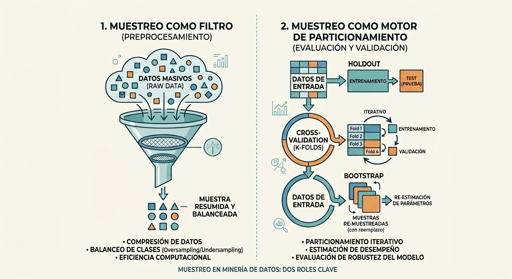

# Muestreo en Minería de Datos: Fundamentos Estadísticos, Estrategias de Reducción y Validación

## El Muestreo en el Ecosistema del Descubrimiento de Conocimiento (KDD)

En la estadística clásica, el muestreo responde históricamente a una limitación de recursos físicos: recolectar información sobre toda la población de interés resulta inviable, destructivo o financieramente prohibitivo [@johnson2014]. En la minería de datos y la ciencia de datos moderna, la motivación es con frecuencia inversa: los datos ya han sido recolectados masivamente en bodegas de datos o flujos continuos (*Big Data*), pero procesar cientos de millones de registros resulta computacionalmente prohibitivo en tiempo de procesamiento y consumo de memoria RAM [@tan2019; @erl2016].

El muestreo actúa en este escenario como una poderosa técnica de **reducción del tamaño de los datos** en la fase de preprocesamiento, permitiendo que algoritmos de alta complejidad polinomial —como los árboles de decisión, modelos basados en distancias o redes neuronales— operen de forma eficiente sin perder la representatividad de los patrones subyacentes. Asimismo, el remuestreo constituye el estándar metodológico para evaluar la capacidad de generalización de los modelos predictivos y mitigar el sobreajuste (*overfitting*) [@provost2013; @torgo2017].



## Fundamentos Estadísticos del Muestreo

Para garantizar que los patrones descubiertos en una muestra sean válidos para la población o el proceso generador de datos, la minería de datos se apoya en los principios fundamentales de la inferencia estadística [@johnson2014].

### Población vs. Muestra, Parámetros y Estimadores

Sea $\Omega = \{1, 2, \dots, N\}$ una población finita o un proceso generador continuo de observaciones, y sea $Y$ una variable aleatoria de interés medida sobre los elementos de la población.

* **Parámetro ($\theta$):** Es una propiedad numérica fija, determinística y generalmente desconocida de la población [@johnson2014]. Ejemplos clásicos incluyen la media poblacional $\mu = \frac{1}{N}\sum_{i=1}^N y_i$, la varianza poblacional $\sigma^2 = \frac{1}{N}\sum_{i=1}^N (y_i - \mu)^2$ o la proporción de clientes en mora $p$.
* **Estimador ($\hat{\theta}$):** Es una función matemática aplicada sobre un conjunto de variables aleatorias observadas en una muestra $s = \{X_1, X_2, \dots, X_n\}$ de tamaño $n$ extraída de $\Omega$ [@johnson2014]. Al ser función de variables aleatorias, $\hat{\theta} = g(X_1, \dots, X_n)$ es en sí mismo una **variable aleatoria** con su propia distribución de probabilidad.

Las propiedades deseables de un estimador estadístico son fundamentales para asegurar la calidad de la minería de datos [@shmueli2018]:

1. **Insesgadez:** El estimador no presenta desviaciones sistemáticas respecto al valor verdadero. El sesgo se define como $\text{Sesgo}(\hat{\theta}) = \mathbb{E}[\hat{\theta}] - \theta$. Un estimador es insesgado si $\mathbb{E}[\hat{\theta}] = \theta$.
2. **Consistencia:** A medida que el tamaño muestral $n$ crece, el estimador converge en probabilidad al parámetro poblacional:
   $$\lim_{n \to \infty} P(|\hat{\theta}_n - \theta| > \epsilon) = 0, \quad \forall \epsilon > 0$$
3. **Eficiencia:** Entre dos estimadores insesgados, el más eficiente es aquel que presenta la menor varianza muestral ($\text{Var}(\hat{\theta}_1) \le \text{Var}(\hat{\theta}_2)$), alcanzando idealmente la cota inferior de Cramér-Rao.

### Distribución Muestral y Error Estándar

La **distribución muestral** es la distribución de probabilidad que adoptaría el estadístico $\hat{\theta}$ si se extrajeran infinitas muestras independientes de tamaño $n$ de la misma población bajo el mismo diseño muestral [@johnson2014].

La dispersión de esta distribución se cuantifica mediante el **Error Estándar** ($SE$):
$$SE(\hat{\theta}) = \sqrt{\text{Var}(\hat{\theta})}$$

Para la media muestral $\bar{X} = \frac{1}{n}\sum_{i=1}^n X_i$ en un muestreo aleatorio simple de variables independientes e idénticamente distribuidas ($i.i.d.$) con varianza poblacional $\sigma^2$:
$$SE(\bar{X}) = \frac{\sigma}{\sqrt{n}}$$

Es vital distinguir entre la **desviación estándar muestral** ($s$), que mide la dispersión y variabilidad física entre las observaciones individuales, y el **error estándar** ($s/\sqrt{n}$), que cuantifica la precisión e incertidumbre del estimador puntual [@johnson2014].

### Leyes Asintóticas: La Base de la Inferencia Masiva

La minería de datos opera bajo dos pilares asintóticos que justifican la estabilidad de los algoritmos cuando se trabaja con volúmenes considerables de datos [@tan2019]:

#### 1. Ley de los Grandes Números (LLN)
Establece que el promedio muestral de observaciones independientes converge al valor esperado poblacional a medida que el tamaño de la muestra aumenta indefinidamente [@johnson2014]:
* **Ley Débil:** Convergencia en probabilidad ($\bar{X}_n \xrightarrow{P} \mu$).
* **Ley Fuerte:** Convergencia casi segura ($P(\lim_{n \to \infty} \bar{X}_n = \mu) = 1$).

*Implicación en Minería de Datos:* A medida que una muestra analítica escala a miles de registros, las frecuencias relativas empíricas de los atributos estabilizan su comportamiento, garantizando que las métricas globales calculadas sobre la muestra sean representativas de la población [@shmueli2018].

#### 2. Teorema del Límite Central (CLT)
Sea $X_1, X_2, \dots, X_n$ una secuencia de variables aleatorias $i.i.d.$ con media $\mathbb{E}[X_i] = \mu$ y varianza finita $\text{Var}(X_i) = \sigma^2 > 0$. Independientemente de la forma que tenga la distribución poblacional original (incluso si es fuertemente asimétrica, bimodal o multimodal), la distribución de la media muestral estandarizada converge asintóticamente a una distribución normal estándar cuando $n \to \infty$ [@johnson2014]:
$$Z_n = \frac{\bar{X}_n - \mu}{\sigma / \sqrt{n}} \xrightarrow{d} \mathcal{N}(0, 1)$$

*Implicación en Minería de Datos:* El CLT permite construir intervalos de confianza asintóticos y pruebas de hipótesis paramétricas sobre el desempeño de algoritmos sin necesidad de asumir normalidad estricta en las variables subyacentes, siempre que el tamaño muestral sea suficientemente representativo [@tan2019].

### El Estimador de Horvitz-Thompson

En muchos entornos de minería de datos, los registros no se seleccionan con probabilidades idénticas (por ejemplo, transacciones sospechosas seleccionadas con mayor frecuencia, o registros ponderados por importancia económica). Para obtener estimaciones insesgadas en presencia de **probabilidades desiguales de selección**, se utiliza el **Estimador de Horvitz-Thompson** (1952) [@tan2019].

Sea $\Omega = \{1, 2, \dots, N\}$ la población y sea $\pi_i = P(i \in s)$ la probabilidad de inclusión de primer orden del elemento $i$ en la muestra $s$, con $\pi_i > 0$ para todo $i$. El estimador de Horvitz-Thompson para el total poblacional $Y = \sum_{i=1}^N y_i$ se define como:
$$\hat{Y}_{HT} = \sum_{i \in s} \frac{y_i}{\pi_i} = \sum_{i \in s} w_i y_i$$
donde $w_i = \frac{1}{\pi_i}$ representa el **factor de expansión** o peso de diseño del elemento $i$. Para la media poblacional $\mu = \frac{Y}{N}$:
$$\hat{\bar{Y}}_{HT} = \frac{1}{N} \sum_{i \in s} \frac{y_i}{\pi_i}$$

#### Demostración de Insesgadez Formal

Definiendo la variable indicadora de pertenencia $I_i = \mathbb{I}(i \in s)$, donde $I_i = 1$ si el elemento $i$ es seleccionado en la muestra y $I_i = 0$ en caso contrario, se tiene que $\mathbb{E}[I_i] = P(i \in s) = \pi_i$. Reescribiendo el estimador:
$$\hat{Y}_{HT} = \sum_{i=1}^N \frac{y_i}{\pi_i} I_i$$
Aplicando la linealidad del operador de esperanza matemática:
$$\mathbb{E}[\hat{Y}_{HT}] = \mathbb{E}\left[ \sum_{i=1}^N \frac{y_i}{\pi_i} I_i \right] = \sum_{i=1}^N \frac{y_i}{\pi_i} \mathbb{E}[I_i] = \sum_{i=1}^N \frac{y_i}{\pi_i} \pi_i = \sum_{i=1}^N y_i = Y$$

*Relevancia en Minería de Datos:* Cuando un analista aplica un sobremuestreo deliberado sobre una clase minoritaria (por ejemplo, fraudes al 50% en el entrenamiento para calibrar un clasificador), las métricas de negocio originales (como la tasa real de pérdida esperada) resultan distorsionadas [@shmueli2018]. El estimador de Horvitz-Thompson permite re-ponderar los casos mediante sus pesos inversos de muestreo ($w_i$), recuperando estimaciones poblacionales insesgadas a partir de muestras intencionalmente desbalanceadas [@tan2019].

### Estimación en Diseños de Encuestas Complejas

En la analítica de negocios, economía y políticas públicas aplicadas a la minería de datos (por ejemplo, al procesar encuestas continuas de hogares, censos económicos o paneles de consumidores), los datos casi nunca provienen de un muestreo aleatorio simple (i.i.d.) [@lumley2010]. Las encuestas probabilísticas complejas integran cuatro componentes estructurales que condicionan la validez de cualquier inferencia:

1. **Factores de Expansión y Ponderadores ($w_i = 1/\pi_i$):** Corrigen las probabilidades dispares de selección, el diseño estratificado intencional y los ajustes por no respuesta. Indican a cuántas unidades de la población representa cada observación muestral [@lumley2010; @tan2019].
2. **Estratificación (`strata`):** División previa de la población en grupos homogéneos independientes (ej. zonas urbanas/rurales o tamaños de empresa). Al asegurar representación fija por estrato, **reduce la varianza del estimador** eliminando la variabilidad inter-estratos [@shmueli2018; @lumley2010].
3. **Conglomerados y Unidades Primarias de Muestreo (PSU / `clusters`):** Muestreo multietápico por agrupaciones naturales (manzanas censales, colegios, sucursales) por conveniencia logística. El agrupamiento induce correlación intra-conglomerado (*intra-cluster correlation*), provocando que las observaciones compartan características no observadas. Esto **infla la varianza muestral** respecto a un muestreo aleatorio simple equivalente, un efecto cuantificado por el **Efecto de Diseño ($DEFF$)** [@lumley2010].
4. **Corrección por Población Finita (FPC):** Factor de ajuste $\sqrt{\frac{N - n}{N - 1}}$ que contrae la estimación del error estándar cuando la fracción de muestreo es sustancial ($n/N > 0.05$) respecto al tamaño poblacional $N$ [@johnson2014; @lumley2010].

*Implicación Crítica en Minería de Datos:* Asumir ingenuamente que un dataset de encuesta compleja es i.i.d. produce dos anomalías graves: estimaciones puntuales de medias y totales **sesgadas** (al ignorar los pesos de diseño) y errores estándar severamente **subestimados** (al ignorar los conglomerados), generando falsos descubrimientos e intervalos de confianza espuriamente optimistas [@tan2019; @lumley2010].

::: {.callout-note}
### Actividad de Clase 1: El Dilema del Muestreo y Horvitz-Thompson 
**Escenario de Negocio:** Una pasarela de pagos procesa 1,000,000 de transacciones diarias, donde la tasa natural de fraude es del 0.1% (1,000 fraudes). Para entrenar un árbol de decisión, el equipo de ciencia de datos extrae una muestra de 20,000 transacciones: 1,000 transacciones fraudulentas (probabilidad de inclusión $\pi_{\text{fraude}} = 1.0$) y 19,000 transacciones legítimas ($\pi_{\text{legítima}} = 19,000 / 999,000 \approx 0.019$).

**Discusión en Parejas:**
1. Si calculamos el monto promedio de fraude directamente sobre la muestra sin ponderar, ¿es un estimador insesgado del fraude poblacional?
2. ¿Por qué es indispensable aplicar los pesos de Horvitz-Thompson ($w_i = 1/\pi_i$) si la gerencia solicita estimar el monto total de dinero defraudado en toda la plataforma a partir de esta muestra? [@tan2019; @shmueli2018].
:::

## Usos del Muestreo como Estrategia de Reducción en Minería de Datos

### ¿Qué y Para Qué del Muestreo en Minería de Datos?

A diferencia del enfoque estadístico clásico donde la muestra es la única información accesible, en minería de datos el analista dispone de la población completa registrada en el almacén de datos [@tan2019; @erl2016]. La decisión de muestrear responde a razones estratégicas y computacionales:

* **Eficiencia y Escalabilidad Algorítmica:** Algoritmos fundamentales como el agrupamiento jerárquico ($O(N^2)$ a $O(N^3)$), máquinas de vectores de soporte ($O(N^2)$ a $O(N^3)$) o búsquedas exhaustivas de patrones frecuentes colapsan ante millones de registros [@tan2019; @torgo2017]. Una muestra adecuada permite aplicar modelos más sofisticados que serían inviables sobre la base completa.
* **Prototipado Rápido y Optimización:** El ciclo exploratorio (ingeniería de características, selección de variables y ajuste de hiperparámetros) avanza a mayor velocidad sobre subconjuntos muestrales manejables antes del entrenamiento final [@provost2013].
* **Muestreo Progresivo (*Progressive Sampling*):** Procedimiento adaptativo propuesto por Provost et al. (1999) que evalúa el rendimiento del modelo comenzando con una muestra pequeña y aumentando su tamaño de forma geométrica hasta alcanzar el punto de saturación (*leveling-off point*), donde incrementos adicionales en datos ya no generan ganancias significativas en la exactitud predictiva [@tan2019].

### Estrategias de Muestreo de Datos

```
                    Estrategias de Muestreo
                               │
       ┌───────────────────────┼───────────────────────┐
       ▼                       ▼                       ▼
Aleatorio Simple         Estratificado            Sistemático
  ├── Con reemplazo        ├── Proporcional         └── Paso fijo k = N/n
  └── Sin reemplazo        └── Desbalanceado            (Riesgo: Periodicidad)
                               (Oversampling)
```

#### 1. Muestreo Aleatorio Simple (MAS / Simple Random Sampling)
Asigna a cada elemento de la población la misma probabilidad idéntica de ser incluido ($\pi_i = n/N$) [@tan2019]:

* **Sin Reemplazo (SRSWOR):** Cada observación seleccionada se retira de la población. Es el método más común para la reducción de datos.
* **Con Reemplazo (SRSWR):** La observación se reintegra a la población y puede ser elegida múltiples veces. Constituye la base del *Bootstrap*.
* *¿Para qué se usa?* Ideal en conjuntos de datos homogéneos donde la variable objetivo posee clases equilibradas y no existen dependencias temporales o espaciales [@tan2019].
* *Limitación:* En presencia de clases raras (como fraude al 0.1%), un MAS puede omitir por completo las observaciones críticas del evento de interés.

#### 2. Muestreo Estratificado (Stratified Sampling)
Divide la población en $L$ subgrupos homogéneos y disjuntos denominados **estratos** (según una variable categórica como tipo de cliente, región o clase objetivo), seleccionando posteriormente una muestra aleatoria independiente dentro de cada estrato [@tan2019; @shmueli2018]:

* **Estratificación Proporcional:** Mantiene en la muestra exactamente las mismas proporciones relativas observadas en la población original ($n_h / n = N_h / N$).
* **Estratificación No Proporcional (Sobremuestreo / *Oversampling*):** Fuerza una mayor representación de estratos minoritarios o de alto riesgo para garantizar que el algoritmo reciba suficientes instancias de aprendizaje [@shmueli2018; @torgo2017].
* *¿Para qué se usa?* Indispensable para problemas de clasificación con clases desbalanceadas (detección de intrusiones, diagnóstico médico, respuesta a campañas de marketing) y para reducir la varianza global del estimador [@shmueli2018].

#### 3. Muestreo Sistemático (Systematic Sampling)
Selecciona un punto de arranque aleatorio $r$ entre $1$ y $k$, y posteriormente extrae cada $k$-ésimo elemento a lo largo del dataset, donde el intervalo de muestreo es $k = \lfloor N/n \rfloor$ [@johnson2014]:
$$s = \{r, r + k, r + 2k, \dots, r + (n-1)k\}$$

* *¿Para qué se usa?* Muy eficiente en flujos continuos de datos (*data streams*), registros transaccionales indexados en tiempo real o archivos masivos en disco donde no se conoce el tamaño total $N$ con anticipación [@erl2016].
* *Riesgo Metodológico Crítico:* Si el dataset presenta una **periodicidad latente o estacionalidad oculta** que coincide con el múltiplo del paso $k$ (por ejemplo, registros tomados cada 24 horas o patrones semanales), la muestra resultante quedará severamente sesgada al capturar siempre el mismo punto del ciclo [@johnson2014].

## Muestreo en Procesos de Evaluación y Validación de Modelos

En la minería de datos predictiva, evaluar un modelo sobre el mismo conjunto de datos utilizado para entrenarlo produce una estimación falsamente optimista debido a la memorización del ruido de la muestra [@provost2013; @shmueli2018]. Para medir la verdadera capacidad de generalización sobre datos no vistos, se emplean esquemas rigurosos de particionamiento y remuestreo [@torgo2017].

### 1. Particionamiento Holdout (Train / Validation / Test)

Consiste en dividir el conjunto de datos disponible en subconjuntos disjuntos mediante muestreo aleatorio (preferentemente estratificado) [@provost2013; @shmueli2018]:

* **Conjunto de Entrenamiento (*Training Set*, ~60-70%):** Utilizado por el algoritmo para aprender los parámetros del modelo (pesos, reglas o coeficientes) [@shmueli2018].
* **Conjunto de Validación (*Validation Set*, ~15-20%):** Utilizado para comparar modelos competidores, ajustar hiperparámetros (como la profundidad de un árbol o el parámetro de regularización $\lambda$) y frenar el sobreajuste [@shmueli2018; @provost2013].
* **Conjunto de Prueba (*Test Set / Holdout Final*, ~15-20%):** Reservado estrictamente hasta el final del proceso. Se evalúa una sola vez para obtener una estimación insesgada del desempeño que tendrá el modelo final en producción [@shmueli2018].

```
┌─────────────────────────────────────────────────────────────┐
│                 Conjunto de Datos Disponible                │
└─────────────────────────────────────────────────────────────┘
                               │
       ┌───────────────────────┴───────────────────────┐
       ▼                                               ▼
┌──────────────────────────────┐        ┌─────────────────────────────┐
│  Datos de Desarrollo (80%)   │        │   Conjunto de Prueba (20%)  │
└──────────────────────────────┘        └─────────────────────────────┘
               │                               (Evaluación Final Única)
       ┌───────┴───────┐
       ▼               ▼
┌──────────────┐┌──────────────┐
│Entrenamiento ││  Validación  │
│    (60%)     ││    (20%)     │
└──────────────┘└──────────────┘
```

### 2. Validación Cruzada ($k$-Fold Cross-Validation)

La validación cruzada divide los datos disponibles en $k$ bloques o particiones disyuntas de idéntico tamaño [@tan2019; @provost2013]. El procedimiento ejecuta $k$ iteraciones de entrenamiento y prueba: en cada iteración $i$, el bloque $i$ se reserva para evaluación (*test fold*), mientras que los restantes $k-1$ bloques se unen para entrenar el modelo [@torgo2017].

El rendimiento estimado corresponde al promedio de las $k$ métricas de evaluación obtenidas [@torgo2017]:

$$\overline{\text{Score}} = \frac{1}{k}\sum_{i=1}^k \text{Score}_i, \quad SE(\overline{\text{Score}}) = \frac{s_{\text{Score}}}{\sqrt{k}}$$

* **Validación Cruzada Estratificada (*Stratified $k$-Fold*):** Garantiza que cada uno de los $k$ pliegues contenga exactamente la misma proporción de clases observada en el conjunto original, siendo el estándar de oro en problemas de clasificación desbalanceada [@torgo2017; @tan2019].

### 3. Remuestreo por Bootstrap

Propuesto por Bradley Efron (1979), el **Bootstrap** es un método no paramétrico de remuestreo basado en el concepto de muestreo aleatorio **con reemplazo** de tamaño $N$ sobre un conjunto original de tamaño $N$ [@tan2019; @torgo2017].

#### La Regla del 63.2% y las Observaciones Fuera de Bolsa (OOB)

Para un dataset de tamaño $N$, la probabilidad de que una observación particular no sea seleccionada en una extracción individual es $(1 - 1/N)$ [@tan2019]. Al realizar $N$ extracciones independientes con reemplazo, la probabilidad de que dicha observación quede completamente fuera de la muestra bootstrap converge asintóticamente al número de Euler [@tan2019; @torgo2017]:
$$\lim_{N \to \infty} \left(1 - \frac{1}{N}\right)^N = e^{-1} \approx 0.3679$$

Por lo tanto, en promedio:

* Cada muestra bootstrap contiene aproximadamente el **63.2%** de las observaciones únicas del conjunto original [@tan2019; @torgo2017].
* El restante **36.8%** de observaciones no seleccionadas conforma el subconjunto **Out-of-Bag (OOB)** [@tan2019].

*Aplicaciones Principales:*

1. **Estimador de Error Bootstrap 0.632:** Pondera el error obtenido en las observaciones OOB con el error de re-sustitución sobre los datos de entrenamiento para reducir el sesgo pesimista en muestras pequeñas [@tan2019; @torgo2017]:
   $$\text{err}_{0.632} = 0.632 \times \text{err}_{\text{OOB}} + 0.368 \times \text{err}_{\text{train}}$$
2. **Intervalos de Confianza Empíricos:** Permite estimar la distribución muestral y cuantiles de métricas complejas (como el estadístico AUC o coeficientes de Gini) sin necesidad de supuestos de normalidad analítica [@torgo2017].
3. **Algoritmos de Ensamble (*Bagging* y *Random Forests*):** Genera múltiples árboles independientes sobre muestras bootstrap paralelas, evaluando el modelo internamente mediante el error OOB sin requerir particiones externas de validación [@tan2019].

## Implementación Práctica en R

::: {.panel-tabset}

### Estrategias de Muestreo de Datos
Implementación de Muestreo Aleatorio Simple, Estratificado y Sistemático utilizando R base y `dplyr`:

```r
library(dplyr)
data(iris)

# Fijar semilla para garantizar reproducibilidad
set.seed(123)

# 1. Muestreo Aleatorio Simple sin reemplazo (20% del dataset)
muestra_mas <- iris %>%
  slice_sample(prop = 0.2, replace = FALSE)

# 2. Muestreo Estratificado Proporcional (conserva 20% por especie)
muestra_estrat <- iris %>%
  group_by(Species) %>%
  slice_sample(prop = 0.2) %>%
  ungroup()

# 3. Muestreo Sistemático (paso fijo k = 5)
k_paso <- 5
arranque_aleatorio <- sample(1:k_paso, 1)
indices_sistematicos <- seq(from = arranque_aleatorio, to = nrow(iris), by = k_paso)
muestra_sistematica <- iris[indices_sistematicos, ]

# Comparación de tamaños obtenidos
cat("Tamaño MAS:", nrow(muestra_mas), "\n")
cat("Tamaño Estratificado:", nrow(muestra_estrat), "\n")
cat("Tamaño Sistemático:", nrow(muestra_sistematica), "\n")
```

### Particionamiento Holdout y Validación Cruzada
Uso de la librería moderna `rsample` (`tidymodels`) para esquemas de validación respetando estratificación:

```r
library(rsample)

set.seed(456)

# 1. Particionamiento Holdout Estratificado (70% Train, 30% Test)
split_inicial <- initial_split(iris, prop = 0.70, strata = Species)
datos_entrenamiento <- training(split_inicial)
datos_prueba        <- testing(split_inicial)

cat("Entrenamiento:", nrow(datos_entrenamiento), "observaciones\n")
cat("Prueba:", nrow(datos_prueba), "observaciones\n")

# 2. Validación Cruzada Estratificada de 5 Folds
pliegues_cv <- vfold_cv(datos_entrenamiento, v = 5, strata = Species)
print(pliegues_cv)
```

### Remuestreo Bootstrap e Intervalos Empíricos
Estimación de la distribución muestral de la correlación de Pearson y cálculo de intervalos de confianza empíricos al 95%:

```r
set.seed(789)
B_repeticiones <- 1000
n_filas <- nrow(iris)
correlaciones_boot <- numeric(B_repeticiones)

for(b in 1:B_repeticiones) {
  # Muestreo con reemplazo del mismo tamaño muestral
  indices_boot <- sample(1:n_filas, size = n_filas, replace = TRUE)
  muestra_b <- iris[indices_boot, ]
  correlaciones_boot[b] <- cor(muestra_b$Sepal.Length, muestra_b$Sepal.Width)
}

# Estimación del Error Estándar e Intervalo Percentil al 95%
se_boot <- sd(correlaciones_boot)
ic_percentil <- quantile(correlaciones_boot, probs = c(0.025, 0.975))

cat("Correlación puntual original:", cor(iris$Sepal.Length, iris$Sepal.Width), "\n")
cat("Error Estándar Bootstrap:", se_boot, "\n")
cat("Intervalo de Confianza 95% (Bootstrap):", ic_percentil, "\n")
```

### Estimador de Horvitz-Thompson en R

Cálculo formal de estimación insesgada con probabilidades desiguales de selección:

```r
# Población simulada con un estrato raro sobre-representado en la muestra
set.seed(101)
N_pob <- 10000
ventas_pob <- c(rnorm(9900, mean = 100, sd = 15), rnorm(100, mean = 500, sd = 50))
tipo_pob <- c(rep("Estándar", 9900), rep("VIP", 100))

# Muestreo intencionalmente desbalanceado: 50 VIPs y 200 Estándar
pi_vip <- 50 / 100
pi_estandar <- 200 / 9900

idx_vip <- sample(which(tipo_pob == "VIP"), size = 50)
idx_std <- sample(which(tipo_pob == "Estándar"), size = 200)

muestra_datos <- data.frame(
  ventas = ventas_pob[c(idx_std, idx_vip)],
  pi_i   = c(rep(pi_estandar, 200), rep(pi_vip, 50))
)

# Cálculo de la media usando promedio simple vs Horvitz-Thompson
media_simple_sesgada <- mean(muestra_datos$ventas)
media_HT_insesgada   <- (1 / N_pob) * sum(muestra_datos$ventas / muestra_datos$pi_i)
media_real_pob       <- mean(ventas_pob)

cat("Media Real Poblacional:", media_real_pob, "\n")
cat("Media Muestral Simple (Sesgada por sobremuestreo):", media_simple_sesgada, "\n")
cat("Media Estimador Horvitz-Thompson (Insesgada):", media_HT_insesgada, "\n")
```

### Encuestas Complejas con srvyr
Estimación puntual de totales, medias e intervalos de confianza incorporando pesos, estratos y conglomerados:

```r
library(survey)
library(srvyr)
library(dplyr)

# 1. Simulación de datos con estructura de encuesta compleja
set.seed(42)
n_obs <- 600
encuesta_raw <- tibble(
  id_individuo = 1:n_obs,
  region       = sample(c("Urbano", "Rural"), size = n_obs, replace = TRUE, prob = c(0.7, 0.3)),
  conglomerado = sample(1:25, size = n_obs, replace = TRUE), # 25 Unidades Primarias de Muestreo (PSU)
  peso_diseno  = if_else(region == "Urbano", runif(n_obs, 80, 120), runif(n_obs, 180, 240)),
  actividad    = sample(c("Comercio", "Servicios", "Manufactura"), size = n_obs, replace = TRUE),
  ingreso_mes  = if_else(region == "Urbano", rnorm(n_obs, 3800, 700), rnorm(n_obs, 2200, 450))
)

# 2. Especificación formal del diseño muestral complejo con srvyr
diseno_srvyr <- encuesta_raw %>%
  as_survey_design(
    ids     = conglomerado,  # Unidades Primarias de Muestreo (PSU / Clusters)
    strata  = region,        # Estratos de diseño
    weights = peso_diseno,   # Factores de expansión (w_i = 1 / pi_i)
    nest    = TRUE           # PSUs anidadas dentro de los estratos
  )

# 3. Estimación poblacional global (media y total con intervalos de confianza al 95%)
resumen_global <- diseno_srvyr %>%
  summarize(
    media_ingreso = survey_mean(ingreso_mes, vartype = c("se", "ci"), level = 0.95),
    total_ingreso = survey_total(ingreso_mes, vartype = c("se", "ci"), level = 0.95)
  )

print(resumen_global)

# 4. Inferencia desagregada por subgrupos con sintaxis tidyverse (group_by)
resumen_sector <- diseno_srvyr %>%
  group_by(actividad) %>%
  summarize(
    participacion = survey_prop(vartype = "ci"),
    ingreso_medio = survey_mean(ingreso_mes, vartype = c("se", "ci"))
  )

print(resumen_sector)
```

:::

## Cápsula de Ejercicios del Muestreo

::: {.callout-tip}
### Ejercicios de Aplicación Práctica (Para portafolio de clase)

1. **Simulación Empírica del Teorema del Límite Central:** Utilizando una distribución fuertemente asimétrica (por ejemplo, una distribución Exponencial con parámetro $\lambda = 0.2$), escriba una función en R que extraiga 2,000 muestras independientes de tamaños $n = 5$, $n = 30$ y $n = 150$. Grafique las distribuciones muestrales resultantes de la media utilizando `ggplot2` y demuestre visual y analíticamente cómo el error estándar decrece proporcionalmente a $1/\sqrt{n}$ aproximándose a una campana gaussiana simétrica [@johnson2014].
2. **Inferencia No Paramétrica con Bootstrap:** Seleccione dos variables numéricas continuas del dataset `Boston` (librería `MASS`). Construya 1,500 remuestreos bootstrap para estimar el intervalo de confianza al 99% de la diferencia de medianas. Verifique qué porcentaje de las muestras bootstrap generó observaciones fuera de bolsa (OOB) cercanas al valor teórico del 36.8% [@tan2019; @torgo2017].
:::
